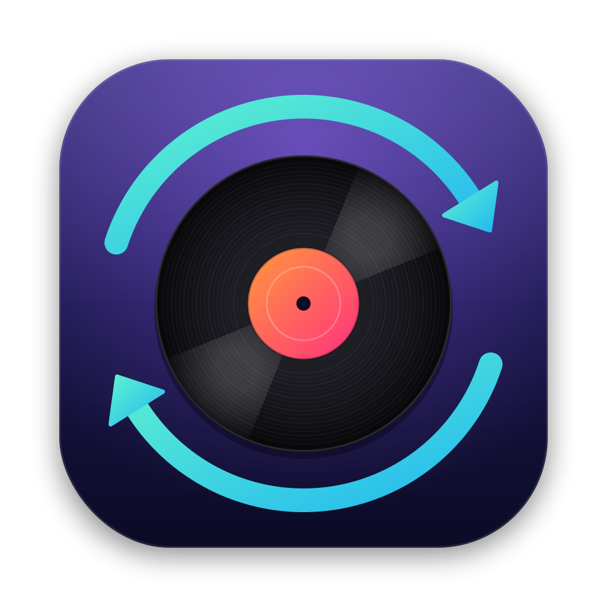

<p align="center">
  
</p>

<h1 align="center">Crate Relay</h1>

<p align="center">
  Keep your <a href="https://www.mixo.dj/">MIXO</a> playlists mirrored in Rekordbox, while Rekordbox stays in charge of BPM, beatgrids and cue points.<br>
  A small macOS menu bar app.
</p>

---

## Why

MIXO is great for organising a library across devices, and Rekordbox's analysis is what you want on the CDJs. But importing MIXO's Rekordbox XML into Rekordbox is a manual step every time, and it drags MIXO's own BPM, grids and cues along with it.

Crate Relay does one job: it watches the XML that MIXO auto-exports and rebuilds your playlists inside a **MIXO** folder in Rekordbox. Each playlist entry is linked to the track **already in your Rekordbox collection** (matched by file path), so everything Rekordbox has analysed stays as it is. Edit a playlist in MIXO, and it's in Rekordbox ready to export to USB.

## Features

- **Automatic**: syncs whenever MIXO re-exports, as soon as Rekordbox is closed. If Rekordbox is open, changes wait and sync the moment you quit it.
- **Playlists only**: never changes BPM, beatgrids, cue points, key, tags, ratings or anything outside its own folder.
- **Backs up first**: copies your Rekordbox library before every change (the last 10 are kept) and restores a backup from the menu.
- **Preview changes** before syncing, and **Sync Now** on demand. It can quit Rekordbox for you.
- **Missing tracks**: lists tracks that are in your MIXO playlists but not yet in your Rekordbox collection. Add them to Rekordbox and they join their playlists on the next sync.
- Folders, nesting and playlist order are all mirrored. Notifications and Open at Login are optional.

<!-- Screenshot: add docs/menu.png once taken -->

## Install

1. Download the latest `Crate-Relay-…-macOS-arm64.zip` (Apple silicon) or `…-x86_64.zip` (Intel) from [Releases](../../releases).
2. Unzip it and drag **Crate Relay** into **Applications**.
3. Open it. The app isn't notarised by Apple, so the first time macOS blocks it: open **System Settings → Privacy & Security**, scroll down and click **Open Anyway**. (On macOS 14 and earlier you can also Control-click the app and choose **Open**.)

Crate Relay lives in the menu bar and has no Dock icon.

## Set up MIXO

In MIXO, open **Settings → Advanced**, turn on **Auto-Export** and choose **Rekordbox XML**. MIXO then writes `~/Music/MIXO/Exports/REKORDBOX/rekordbox.xml` about 20 seconds after each change, and that's the file Crate Relay watches. If yours is somewhere else, choose it from **Settings → MIXO Export…** in the menu.

Crate Relay finds Rekordbox's library at `~/Library/Pioneer/rekordbox/master.db` (Rekordbox 6 and 7).

## Day to day

1. Organise playlists in MIXO.
2. Crate Relay syncs them into the **MIXO** folder in Rekordbox (or waits until you quit Rekordbox).
3. Open Rekordbox and export to USB as usual.

Some rules of thumb:

- **Treat the MIXO folder in Rekordbox as read-only.** Anything you change inside it is overwritten on the next sync. Your other playlists are never touched.
- **New tracks need adding to Rekordbox once** (drag them into Collection so Rekordbox analyses them). Until then they're listed under *tracks not in Rekordbox yet* in the menu.
- **Don't use MIXO's direct "Rekordbox" export** (the one that writes `master.db`) alongside this. It writes MIXO's cues and beatgrids into Rekordbox, which is exactly what Crate Relay avoids.

### Menu bar icon

| Icon | Meaning |
| --- | --- |
| Record with arrows | Up to date |
| Arrows spinning | Checking or syncing |
| Pause badge | Changes are waiting (Rekordbox is open, or auto-sync is off) |
| Dot badge | Needs attention (export not found, or an error) |
| Faded arrows | Automatic sync is off |

## Safety

Crate Relay edits Rekordbox's library database directly, using [pyrekordbox](https://github.com/dylanljones/pyrekordbox). Neither AlphaTheta nor Pioneer DJ supports third-party tools doing this, so Crate Relay is careful about it:

- It only writes while Rekordbox is closed.
- It backs up `master.db` and `masterPlaylists6.xml` before every change, to `~/Library/Application Support/Crate Relay/Backups`.
- It only ever creates, reorders or deletes playlists and folders inside its own top-level folder, and only adds or removes entries in those playlists.
- It never creates, edits or deletes tracks.

To undo a sync, choose **Backups → Restore a Backup…**. Rekordbox also keeps its own `master.backup.db` files in `~/Library/Pioneer/rekordbox/`.

Tested with Rekordbox 7.2 on macOS. Keep your own backups of your Rekordbox library too.

## Command line

The sync engine also works without the app:

```sh
pip install crate-relay            # or: pip install -e . from a clone
crate-relay                        # preview what would change
crate-relay --apply                # sync (Rekordbox must be closed)
crate-relay --json                 # machine-readable result
crate-relay --help
```

## Build from source

Requires macOS 11+ and Python 3.9+ (the Xcode Command Line Tools Python, python.org or Homebrew).

```sh
git clone https://github.com/OWNER/crate-relay.git
cd crate-relay
./scripts/build.sh          # creates .venv, builds dist/Crate Relay.app and a release zip
open "dist/Crate Relay.app"
```

Everything is installed into the project's own `.venv`, so your system Python is left alone.

Other useful commands:

```sh
make dev      # create .venv with the app + dev tools
make run      # run the menu bar app from source
make test     # run the tests
make icons    # regenerate the icons from scripts/make_icons.py
```

Tagging a release (`git tag v1.0.0 && git push --tags`) runs the GitHub Actions workflow, which builds Apple silicon and Intel zips and attaches them to a draft release.

## Troubleshooting

- **"MIXO export not found"**: turn on Auto-Export → Rekordbox XML in MIXO, or point the app at the file under Settings.
- **Changes never sync**: check Rekordbox is fully quit (not just its window closed). The status line says when it's waiting.
- **A playlist is missing tracks**: open *tracks not in Rekordbox yet*. Those files aren't in your Rekordbox collection, or their path differs from the one MIXO has.
- **Something looks wrong**: see **Show Log** (`~/Library/Logs/Crate Relay/`) and restore a backup if needed. Issues are welcome.

## Credits

Built on [pyrekordbox](https://github.com/dylanljones/pyrekordbox) (MIT) and [rumps](https://github.com/jaredks/rumps) (BSD).

Crate Relay is an independent project. It is not affiliated with, or endorsed by, MIXO or AlphaTheta / Pioneer DJ. Rekordbox is a trademark of AlphaTheta Corporation.

## License

[MIT](LICENSE)
